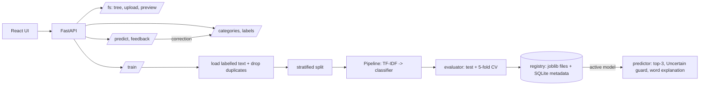

# 🏷️ Document Classifier ML

Train your own document classifier in the browser. Label documents from a local folder, train three classical ML
models (TF-IDF + Logistic Regression / Linear SVM / Naive Bayes), compare them side by side, then predict
categories with confidence, fix mistakes (feedback becomes new labels) and roll back model versions.
Everything runs locally with scikit-learn — **no LLM, no cloud, no paid APIs.**

> Project 2 of 5 · teaches the ML lifecycle: data → features → training → evaluation → deployment.

| Label | Metrics | Predict |
|---|---|---|
| _screenshot placeholder_ | _screenshot placeholder_ | _screenshot placeholder_ |

## Architecture



## Quick start (Windows PowerShell)

```powershell
git clone https://github.com/kamalnathmurugan14/doc-classifier-ml; cd doc-classifier-ml
cd backend
python -m venv .venv; .\.venv\Scripts\Activate.ps1
pip install -r requirements.txt
copy .env.example .env          # set DOCS_ROOT=C:/Users/you/Documents/docs (or keep ./sample_docs)
uvicorn app.main:app --reload    # http://localhost:8000/docs

cd ..\frontend                   # new terminal
npm install
npm run dev                      # http://localhost:5173
```
macOS/Linux: `source .venv/bin/activate`, `cp .env.example .env`.

**Zero-data path:** open *Label* → **Generate synthetic dataset** (5 classes × 20 documents, already labelled) →
*Train* → *Metrics* → *Predict*. Ollama is **not** needed for this project.

## Configuration (`backend/.env`)
| Variable | Default | Meaning |
|---|---|---|
| `DOCS_ROOT` | `./sample_docs` | Folder with your documents |
| `DATA_DIR` | `./data` | SQLite DB + saved models (git-ignored) |
| `MAX_UPLOAD_MB` | `25` | Upload limit |
| `ALLOWED_EXTENSIONS` | `pdf,docx,txt,md` | Allow-list |
| `TEST_SIZE` | `0.2` | Held-out fraction (0.05–0.5) |
| `RANDOM_SEED` | `42` | Reproducible splits |
| `MIN_DOCS_PER_CLASS` | `5` | Training refused below this |
| `MAX_FEATURES` / `NGRAM_RANGE` | `20000` / `1,2` | TF-IDF vocabulary |
| `UNCERTAIN_BELOW` | `0.5` | Confidence under this shows "Uncertain" |
| `CORS_ORIGINS` | `http://localhost:5173` | Allowed origins |

## API overview
Interactive docs at `/docs`; spec exported to [`docs/openapi.json`](docs/openapi.json). Errors: `{"error":{"code","message"}}`.

| Endpoint | Purpose |
|---|---|
| `GET /health` | `{status, version, active_model}` |
| `GET /fs/tree`, `POST /fs/upload`, `GET /fs/preview` | Path-safe explorer, upload, text preview |
| `GET/POST /categories`, `DELETE /categories/{id}` | Categories (with label counts) |
| `POST /labels`, `GET /labels?category=`, `DELETE /labels/{id}` | Labels |
| `POST /datasets/synthetic {per_class}` | Generate + label fake documents |
| `POST /train {algos?, test_size?}` → 202 · `GET /train/{run_id}` | Train and poll |
| `GET /models` · `GET /models/{id}/metrics` · `POST /models/{id}/activate` · `GET /models/{id}/card` | Registry, metrics, rollback, markdown model card |
| `POST /predict` · `POST /predict-folder` + `GET /predict-folder/{job}` · `POST /feedback` | Predict and learn from corrections |

## Testing
```bash
make test                                  # or .\scripts\test.ps1
cd backend && pytest --cov=app             # 37 tests, ~94 % coverage
cd frontend && npm run test:all            # eslint + tsc + vitest + build
cd frontend && npm run test:e2e            # Playwright (starts its own backend)
```

## Security
All paths go through `safe_resolve()` (traversal, absolute paths, symlink escapes rejected); uploads are allow-listed,
size-limited, sanitized, never overwrite; model paths from the DB are reduced to a basename before loading.
**Note:** joblib/pickle files can execute code when loaded — only load models your own backend trained.

## Troubleshooting
- *"Each category needs at least 5 …"* — label more documents (or use the synthetic dataset).
- *Everything scores 100 %* — the synthetic data is easy; try `noise` 0.3 via `POST /datasets/synthetic`.
- *"No trained model yet"* — train first.

## Roadmap
Active learning (ask me to label the most uncertain files) · class weights for imbalance · OCR for scanned PDFs.

See also [Architecture](docs/ARCHITECTURE.md) · [Learning notes + ML concepts](docs/LEARNING_NOTES.md) · [Demo script](docs/DEMO.md)
